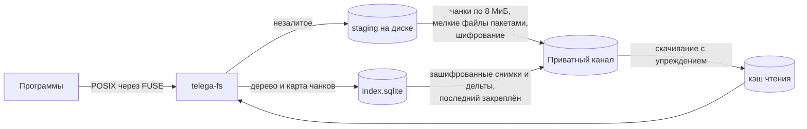
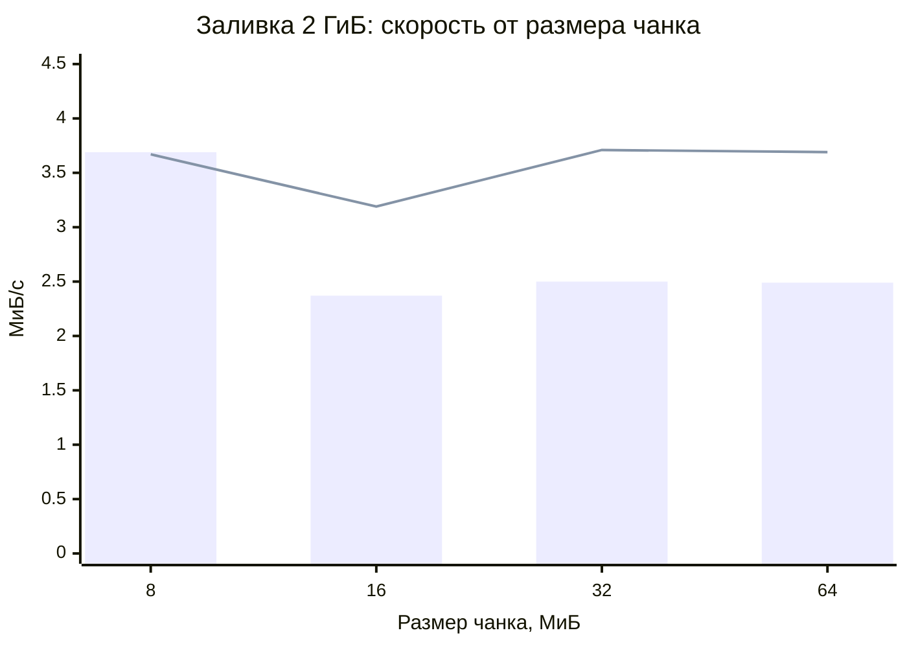
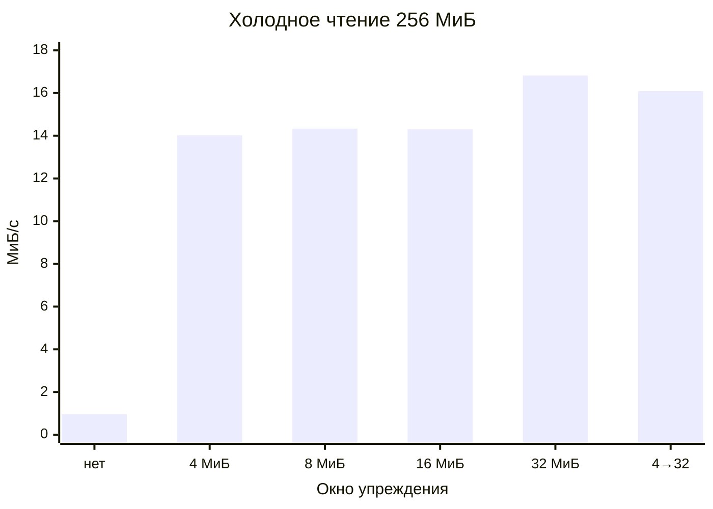
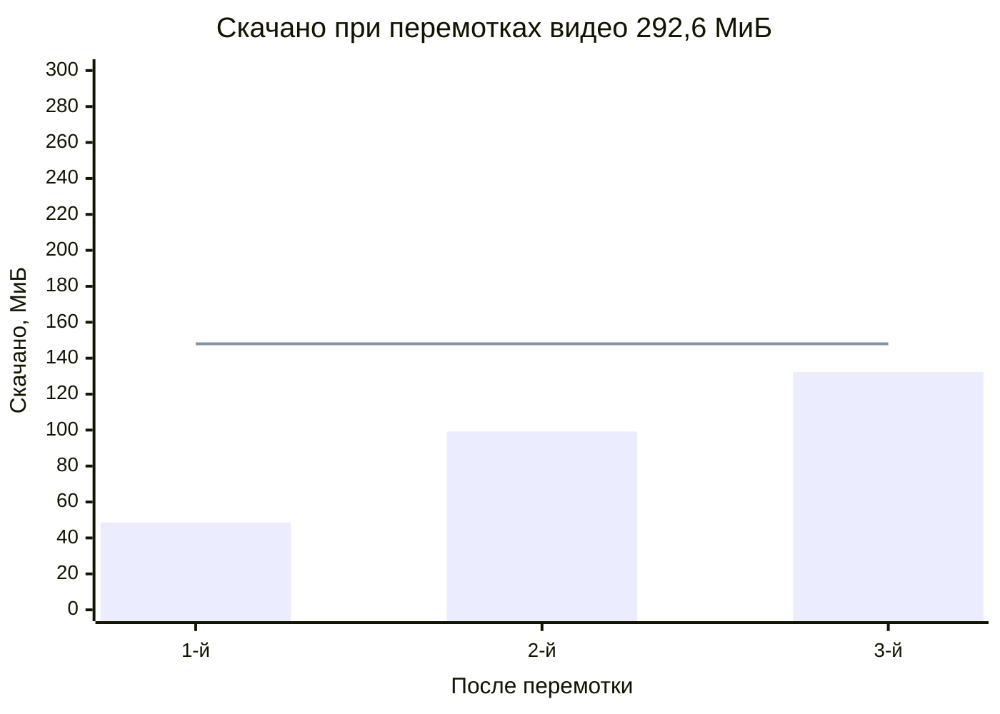
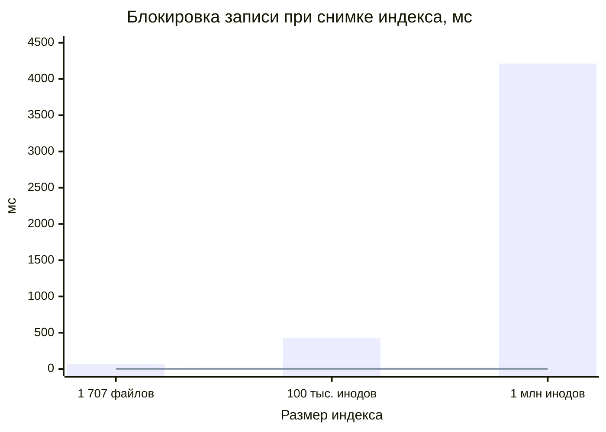

# telega-fs

[](https://github.com/postusername/telega-fs/actions/workflows/ci.yml)

Файловая система для Linux, которая хранит данные в вашем приватном Telegram-канале: монтируете каталог, пишете в него как в обычный, а файлы шифруются на клиенте и уходят в канал.

> [!WARNING]
> Telegram не гарантирует хранение: канал, бот или аккаунт могут пропасть. telega-fs не заменяет резервную копию. Нужен свой `api_id` с my.telegram.org, рекомендуемый режим — бот в вашем канале. Проект не связан с Telegram.

## Промпт для установки

Отдайте его своему агенту (Claude Code, Codex и т. п.) в пустом каталоге:

```text
Установи мне telega-fs — файловую систему поверх приватного Telegram-канала.

1. Склонируй https://github.com/postusername/telega-fs и прочитай README.md,
   docs/build.md, docs/cli.md и docs/repair.md.
2. Поставь зависимости, собери TDLib и telega-fs пресетом release по docs/build.md.
   Перед сборкой TDLib посмотри свободную память и выбери -j по ней.
   Бинарник положи в ~/.local/bin.
3. Проведи меня по шагам через то, что могу сделать только я:
   получить api_id и api_hash на https://my.telegram.org, создать бота у @BotFather,
   создать приватный канал, добавить туда бота администратором с правами
   публиковать, редактировать и удалять сообщения, узнать id канала.
4. Создай ~/.config/telega-fs/config.toml (права 0600, режим бота) и дай мне
   самому вписать туда api_id, api_hash и id канала. Команды, которые
   спрашивают токен бота и пароль, тоже дай мне запустить самому.
5. Помоги выбрать пароль или keyfile и напомни сохранить копию:
   без него данные не восстановить.
6. Сделай init, смонтируй ФС в ~/tg и проверь: запиши файл, telega-fs sync,
   telega-fs status.

Никуда не коммить и не отправляй мои секреты. В Telegram ничего не делай,
кроме этой настройки.
```

Вручную: сборка — [docs/build.md](docs/build.md), команды и настройки — [docs/cli.md](docs/cli.md).

## Как устроено



Файлы режутся на чанки по 8 МиБ, каждый чанк шифруется (XChaCha20-Poly1305) и уходит в канал документом. Мелкие файлы собираются в пакеты, самые мелкие лежат прямо в индексе, одинаковые чанки не заливаются дважды. Индекс ФС — база SQLite. После каждого коммита в канал уходит её зашифрованная дельта или снимок, а последний блоб закрепляется: по нему ФС монтируется на любой машине. Запись сначала ложится на локальный диск, заливка и коммит идут в фоне, `fsync` ждёт их. При чтении telega-fs качает только нужные куски и заранее подтягивает следующие, поэтому видео смотрится без полного скачивания.

**Что видит Telegram:** сколько документов в канале, их размеры и когда они отправлены. Содержимое, имена файлов, структуру каталогов и точные размеры файлов он не видит. Подмена или порча любого документа обнаруживается при чтении.

## Ограничения

- Только Linux (x86_64 и aarch64).
- Один писатель: на запись ФС монтирует одна машина, остальные могут только читать (`--ro`).
- Нет жёстких ссылок, xattr, ACL, `fallocate`, FIFO, сокетов и устройств.
- Заливка не быстрее лимитов Telegram, около 3,7 МиБ/с.
- Пока сети нет, запись идёт в локальный staging и упирается в его лимит.
- Лимиты отправки измерены только в режиме бота, для режима пользователя взяты те же.
- Пароль или keyfile потерян — данные не восстановить.

## Замеры

Все числа взяты из экспериментов на боевых серверах Telegram в режиме бота (ноутбук, Wi-Fi). Отчёты и сырые данные лежат в [docs/experiments/](docs/experiments/).

**Заливка упирается в лимиты Telegram, а не в канал.** Столбцы — набор 2 ГиБ (большой файл и файлы по 1–10 МиБ), линия — один файл 1 ГиБ. При чанке 8 МиБ мелкие документы уходят альбомами, и заливка выходит на лимит по байтам. Медианы 5 повторов:



**Чтение с упреждением.** Последовательное чтение 256 МиБ с пустого кэша кусками по 128 КиБ, как `sha256sum`. Без упреждения каждый кусок — отдельный запрос в сеть. «4→32» — окно растёт с 4 до 32 МиБ, так по умолчанию. Медианы 5 повторов:



**Видео не качается целиком.** Видео 292,6 МиБ с пустого кэша, три перемотки с воспроизведением после каждой. Линия — предел, заложенный в тест: три окна упреждения, округлённые до чанков. Один прогон:



**Коммит не останавливает запись.** Сколько запись ждёт, пока снимается снимок индекса. Столбцы — прямолинейный `VACUUM INTO` под блокировкой, линия — способ, который используется: около 2 мс при любом размере индекса:



| Что | Сколько |
|---|---|
| Устойчивая заливка | 3,7 МиБ/с, упор в лимит 224 МиБ в минуту |
| Холодное чтение большого файла | 7,5–17 МиБ/с |
| Память демона при копировании файла 10 ГиБ | 75 МиБ (`VmHWM`) |
| Монтирование на новой машине с пустым кэшем | около 1 с |
| Документов в канале на «домашний каталог» (659 тыс. файлов, 65 ГиБ) | 9 346 вместо 724 926 без пакетов |
| Холодное чтение мелкого файла | около 120 мс |

## Документация

- [docs/cli.md](docs/cli.md) — команды, `config.toml`, режимы бота и пользователя.
- [docs/repair.md](docs/repair.md) — что делать, если что-то пошло не так.
- [docs/build.md](docs/build.md) — сборка.
- [docs/SPEC.md](docs/SPEC.md) — полное устройство: форматы, коммит, гарантии после сбоя, работа с Telegram.
- [docs/experiments/](docs/experiments/) — эксперименты, по которым выбраны параметры.
